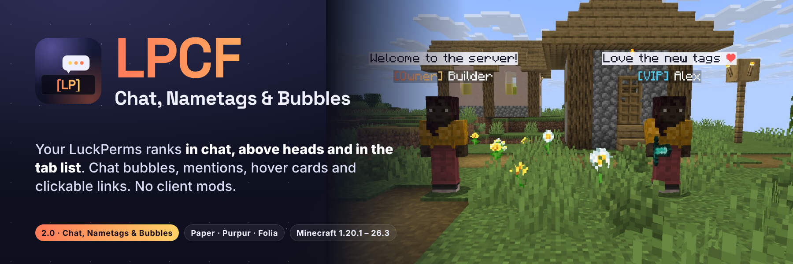

# LPCF: Chat, Nametags & Bubbles



Your LuckPerms ranks everywhere players look: **in chat, above their heads and in the tab list**, plus chat bubbles,
mentions, clickable links and hover cards. One jar for **Paper, Purpur and Folia, Minecraft 1.20.1 to 26.3**. No
client mods, no resource pack, no ProtocolLib.

Requires [LuckPerms](https://luckperms.net/). [PlaceholderAPI](https://modrinth.com/plugin/placeholderapi) is optional.

## Features

- **Chat formats** from LuckPerms prefixes, suffixes and meta, per group, per track and per world, in MiniMessage
  (gradients, hex) or legacy `&` / `&#RRGGBB` codes, with PlaceholderAPI placeholders.
- **Nametags above heads made of text displays**: gradients, hex colours and several lines, refreshed when
  LuckPerms changes. They follow players through teleports, deaths and dimension changes (and `/home`, `/spawn`,
  `/tpa` plugins keep working), hide while the player is invisible, in spectator mode or vanished, and dim while
  sneaking like the vanilla tag. The vanilla name is hidden underneath. **They work on Folia too**, where scoreboard
  teams do not exist: there the tag rides the player, which hides the vanilla name just the same.
- **Chat bubbles**: public messages float above the speaker for a few seconds. Players can turn theirs off with
  `/lpcf bubbles`. Messages that do not reach everyone (channels, staff chat, muted players) never get a bubble.
- **Hover cards and click-to-message** on names in chat (rank, world, anything from PlaceholderAPI).
- **Mentions**: `@Steve` or just `Steve` is highlighted and Steve hears a ping and sees an action-bar notice.
- **Clickable links**, **`[ITEM]`** with the item's tooltip, and **emoji shortcuts** (`<3` → ❤, `:star:` → ★, your own).
- **Tab list**: names from your format, sorted by LuckPerms weight, with a header and footer.
- **Join, first-join and quit messages**, per group.
- **Safe chat**: what players type is never parsed as a format or passed to PlaceholderAPI. `lpcf.colorcodes`
  allows colours, decorations, gradients and rainbow, never click or hover events.
- `/lpcf debug [player]` shows the player's group, prefix, suffix, which format applies and why, and the nametag mode.
- Folia-safe throughout (every player task runs on that player's region thread), bStats, optional Modrinth update check.

## Compatibility

| Server | Minecraft | Java | Notes |
|--------|-----------|------|-------|
| Paper | 1.20.1 to 26.3 | 17+ (the server's own) | Everything |
| Purpur | 1.20.1 to 26.3 | 17+ | Everything (Purpur is built on Paper) |
| Folia | 1.20.1 to 26.3 | 17+ | Everything except `nametags.style: team` (Folia has no scoreboard teams; the default text-display nametags work) |
| Spigot / Bukkit | | | Not supported: LPCF needs Paper's chat API |

Tested in game with real clients on Paper 1.20.1, 1.20.4, 1.21.1, 1.21.11, 26.1.2, 26.2 and 26.3, Purpur 1.21.1 and 26.3, and
Folia 26.2 and 26.3 (see [docs/QA-2.0.0.md](docs/QA-2.0.0.md)). The tab list is sorted by LuckPerms group weight
through the player-list order on 1.21.2 and newer (Folia included), and by prefix weight through team names before
that (not on Folia).

## Install

1. Install LuckPerms (and optionally PlaceholderAPI).
2. Put `LPCF-2.0.0.jar` in `plugins/`. **Upgrading from 1.x**: delete `LuckPermsChatFormatterFolia-*.jar`.
3. Start the server and edit `plugins/LPCF/config.yml`, then `/lpcf reload`.

Upgrading from 1.x keeps your settings: on first start `plugins/LuckPermsChatFormatterFolia` is moved to
`plugins/LPCF`, the old config is saved as `config-1.x-backup.yml`, and the new settings are added to `config.yml`
with their comments. Your head nametags keep showing your old `nametag-format`, now with full colours. The new tab
header/footer and join/quit messages start disabled on upgraded servers (they may clash with a plugin you already
use for that); new installs get them enabled.

Download from [Modrinth](https://modrinth.com/plugin/lpcf-chat-formatter) or CurseForge.

## Commands and permissions

| Command | Permission | Default | What |
|---------|------------|---------|------|
| `/lpcf reload` | `lpcf.reload` | op | Reload `config.yml` (also receives update notices) |
| `/lpcf debug [player]` | `lpcf.debug` | op | Group, prefix, suffix, chosen format, nametag mode |
| `/lpcf preview <message>` | `lpcf.preview` | op | Your chat line, shown only to you (from the console: `/lpcf preview <player> <message>`, with its JSON) |
| `/lpcf bubbles [on\|off]` | `lpcf.bubbles.toggle` | everyone | Turn your own chat bubbles on or off |

| Permission | Default | What |
|------------|---------|------|
| `lpcf.colorcodes` | nobody | Colours, decorations, gradients and rainbow in chat messages |
| `lpcf.itemplaceholder` | everyone | `[ITEM]` in chat |
| `lpcf.mention` | everyone | Mentions in the player's messages are highlighted and notify |
| `lpcf.links` | everyone | Links in the player's messages are clickable |
| `lpcf.replacements` | everyone | Emoji shortcuts apply to the player's messages |
| `lpcf.bubbles` | everyone | The player's public messages show as bubbles |
| `lpcf.admin` | op | `lpcf.reload`, `lpcf.debug` and `lpcf.preview` |

## Configuration

`plugins/LPCF/config.yml` (excerpt; the file explains every option):

```yaml
chat-format: "{prefix}{username-color}{name}<dark_gray> »<reset> {message-color}{message}"
group-formats:
  admin: "<gradient:#ff5f6d:#ffc371>[Admin]</gradient> {name}<dark_gray> »<reset> {message}"
world-formats:
  world_nether: "<red>[Nether]</red> {prefix}{name}<dark_gray> »<reset> {message}"

nametags:
  style: auto          # auto (text displays), team (1.x scoreboard teams), off
  lines:
    - "{prefix}{username-color}{name}{suffix}"

bubbles:
  enabled: true
  format: "<#1b1d2e>{message}"
  background: "#E8F4F5FF"   # #AARRGGBB, or "default" for the vanilla nametag background

tab:
  sort-by-weight: true
  header-footer:
    enabled: true
    header: ["", "<gradient:#ff7a59:#ffd166><bold>Welcome to the server</bold></gradient>", ""]
    footer: ["", "<gray>{online}/{max-players} online · {ping} ms", ""]
```

Placeholders: `{name}`, `{displayname}`, `{prefix}`, `{suffix}`, `{prefixes}`, `{suffixes}`, `{group}`, `{world}`,
`{username-color}`, `{message-color}` (LuckPerms meta), `{message}`, and any `%placeholder%` from PlaceholderAPI.

## Build

Any JDK 17 or newer:

```bash
./gradlew test shadowJar
```

Output: `build/libs/LPCF-<version>.jar` (Java 17 bytecode, compiled against the Paper 1.20.1 API).
`tools/qa/` runs the in-game checks on real servers and clients; see [CONTRIBUTING](CONTRIBUTING.md).

## Publishing (maintainers)

`.github/workflows/publish.yml` uploads `releases/LPCF-<version>.jar` to Modrinth and CurseForge (Actions > Publish >
Run workflow, or a `v*.*.*` tag). Secrets: `MODRINTH_TOKEN`, `CURSEFORGE_TOKEN`, `CURSEFORGE_API_KEY`. Project ids
default to Modrinth `cq7XqCTD` and CurseForge `1483836` (override with the `MODRINTH_ID` / `CURSEFORGE_ID` variables).

## Links

[Discord](https://discord.gg/SAmd9fhNhr) · [Issues](https://github.com/MeherBenSalem/LPCF/issues) ·
[Support us](https://nightbeam.dev/support) · [Code of Conduct](CODE_OF_CONDUCT.md) · [Security](.github/SECURITY.md)

Made by NightBeam Studio. Licensed under the [Apache License, Version 2.0](LICENSE).
