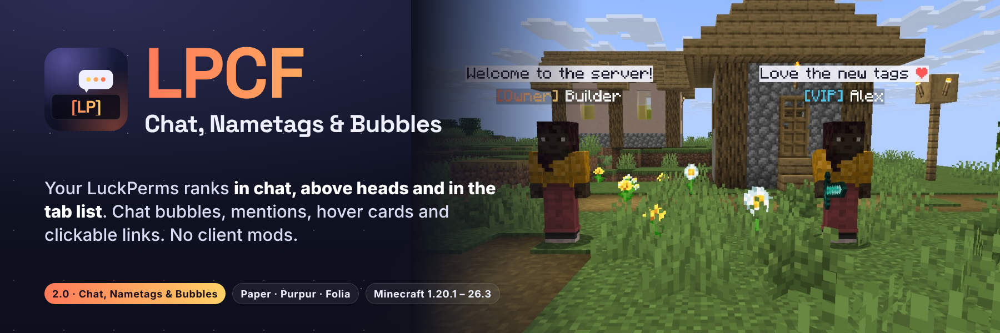

**[Discord](https://discord.gg/TJc3CxR4jK) · [Source and issues](https://github.com/MeherBenSalem/LPCF)**

**Your LuckPerms ranks everywhere players look.** LPCF puts your prefixes in chat, **above every player's head** and
in the tab list, with full gradients and hex colours. Public chat pops up as a **bubble** over the speaker, names in
chat show a hover card and open a private message on click, and `@mentions` ping the player. Nothing to install on
the client: no mod, no resource pack, no ProtocolLib.

Paper, Purpur and Folia · Minecraft 1.20.1 to 26.3 in one jar · LuckPerms required, PlaceholderAPI optional


Version 2.0, **Chat, Nametags & Bubbles**, turns a chat formatter into the rank display for your whole server:

- **Nametags above heads** made of text displays: gradients, hex colours, several lines, PlaceholderAPI, and **on Folia too**
- **Chat bubbles** over the player who is talking
- **Hover cards and click-to-message** on names, **@mentions** with a ping, **clickable links**, **emoji shortcuts**
- **Tab list** sorted by LuckPerms weight, with a header and footer
- **Join, new-player and quit messages** per group, and **world formats**
- **`/lpcf debug`** answers "why is my prefix not showing?"
- **Safer chat**: what players type can no longer trigger placeholders or click events
- **1.20.1 and 1.21.x work again** (1.2.4 and 1.2.5 loaded on 26.x and nothing older), and your 1.x config carries over


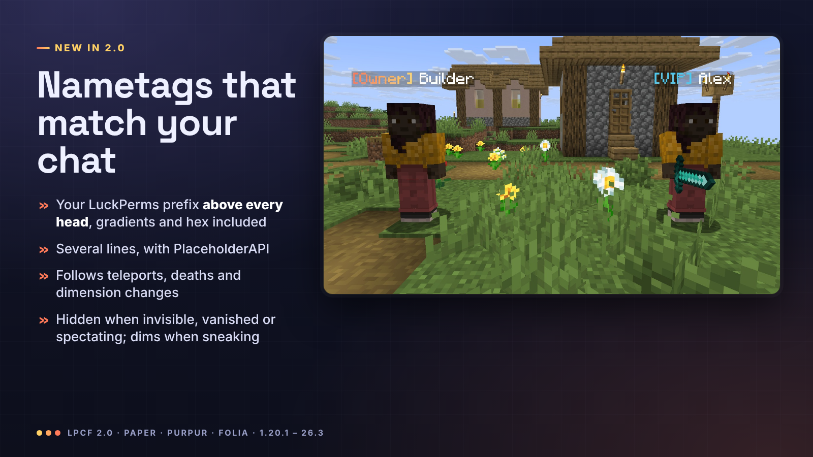

Every player gets a nametag built from `nametags.lines` in `config.yml`: your LuckPerms prefix, suffix and meta,
gradients, hex colours, as many lines as you like and any PlaceholderAPI placeholder (health, guild, level...).

- It refreshes by itself when you change a rank in LuckPerms
- It follows teleports, deaths, respawns and dimension changes, and works with `/home`, `/spawn` and `/tpa` plugins
- It hides while the player is invisible, in spectator mode, dead or vanished, and dims while they sneak
- Players never see their own tag in front of their camera
- The vanilla name is hidden underneath, on Folia too (Folia has no scoreboard teams; there the tag rides the player,
  and Minecraft does not draw the name of a player carrying something)
- Prefer the old way? `nametags.style: team` keeps classic scoreboard-team nametags


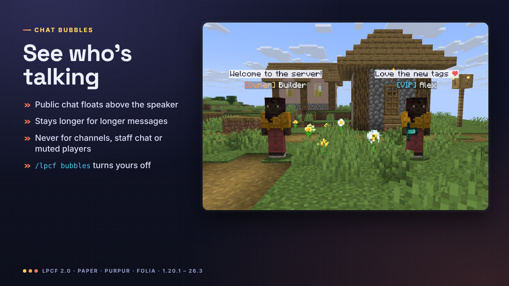

When a player chats, the message floats above their head for 3 to 10 seconds (longer messages stay longer), so
everyone nearby sees who said what. A bubble appears just for messages that reach every player: when another plugin sends a
message to a channel, staff or party chat alone, or cancels it (a mute), there is no bubble. Players turn their own
bubbles off with `/lpcf bubbles off`.


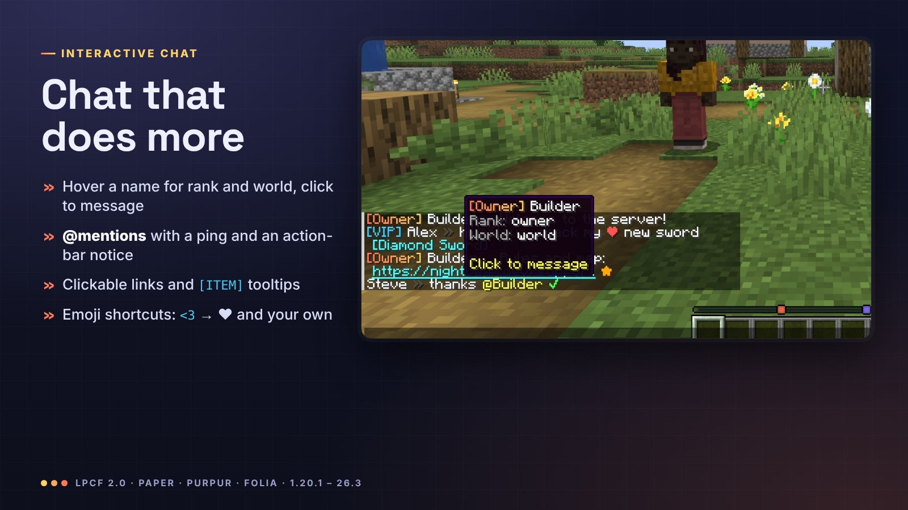

- **Formats** per LuckPerms group, per track and per world, falling back to `chat-format`, in MiniMessage or
  `&` / `&#RRGGBB` codes, with `{prefix}`, `{suffix}`, `{group}`, `{world}`, `{username-color}`, `{message-color}` and
  PlaceholderAPI
- **Hover a name** to see the player's rank and world (your lines), **click it** to start a `/msg`
- **Mentions**: `@Steve` or just `Steve` is highlighted, and Steve hears a ping and sees "Alex mentioned you"
- **Links** become clickable, **`[ITEM]`** shows the held item with its tooltip
- **Emoji shortcuts**: `<3` → ❤, `:star:` → ★, `:check:` → ✔, `:shrug:` → ¯\\\_(ツ)\_/¯, and any you add


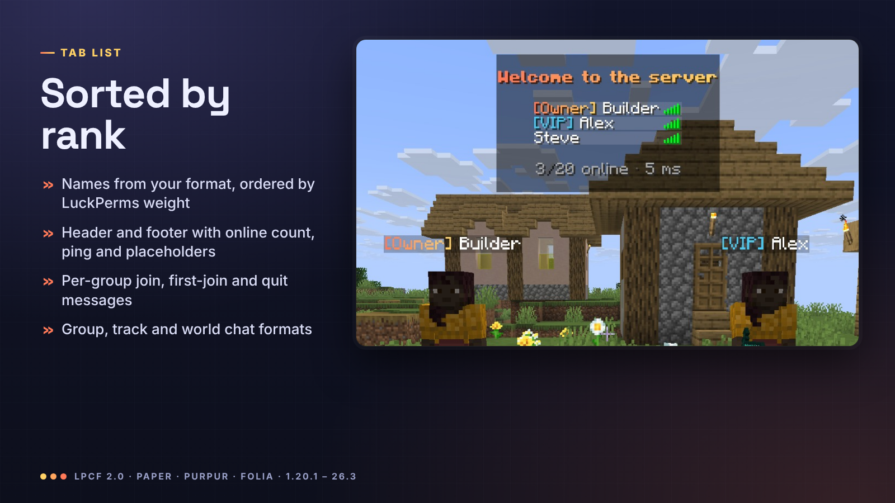

The tab list shows your `nametag-format`, sorted by LuckPerms weight (highest at the top: the group weight on 1.21.2 and
newer, Folia included; the prefix weight through team names before that, except on Folia), under a header and footer
with `{online}`, `{max-players}`, `{ping}` and placeholders. Join, new-player and quit messages can differ per group.


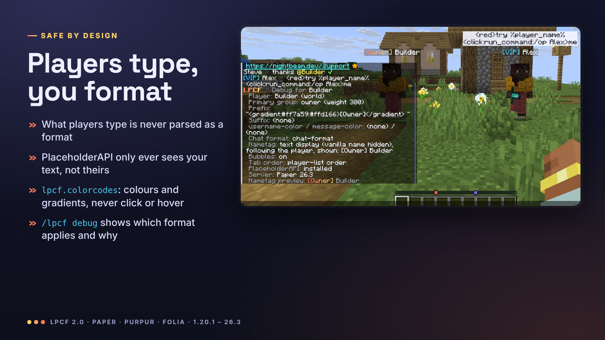

What players type is added to the chat line after your format is read, so it is never treated as a format and never
reaches PlaceholderAPI: typing `%player_ip%` or `<click:run_command:/op me>` just shows those characters.
`lpcf.colorcodes` lets trusted players use colours, decorations, gradients and rainbow, but never click or hover events.

`/lpcf debug <player>` lists the player's group and weight, prefix, suffix, meta colours, **which chat format applies
and why**, and what their nametag shows.


| Command | Permission | Default | What |
|---------|------------|---------|------|
| `/lpcf reload` | `lpcf.reload` | op | Reload `config.yml` |
| `/lpcf debug [player]` | `lpcf.debug` | op | Group, prefix, suffix, chosen format, nametag |
| `/lpcf preview <message>` | `lpcf.preview` | op | Your chat line, shown just to you |
| `/lpcf bubbles [on/off]` | `lpcf.bubbles.toggle` | everyone | Your own chat bubbles |

Other permissions: `lpcf.colorcodes` (styling in chat, nobody by default), and `lpcf.mention`, `lpcf.links`,
`lpcf.replacements`, `lpcf.itemplaceholder`, `lpcf.bubbles` (everyone by default). `lpcf.admin` grants the admin commands.


```yaml
chat-format: "{prefix}{username-color}{name}<dark_gray> »<reset> {message-color}{message}"
group-formats:
  admin: "<gradient:#ff5f6d:#ffc371>[Admin]</gradient> {name}<dark_gray> »<reset> {message}"

nametags:
  style: auto        # auto (text displays), team (scoreboard teams), off
  lines:
    - "{prefix}{username-color}{name}{suffix}"
    - "<red>❤ %player_health_rounded%"

bubbles:
  enabled: true
  format: "<#1b1d2e>{message}"
  background: "#E8F4F5FF"   # #AARRGGBB, or "default" for the vanilla nametag background

tab:
  sort-by-weight: true
  header-footer:
    enabled: true
```

Upgrading from 1.x: replace the jar and restart. Your `plugins/LuckPermsChatFormatterFolia` folder moves to
`plugins/LPCF`, the old config is kept as `config-1.x-backup.yml`, and the new settings are added with their
explanations. Your nametags keep showing your old `nametag-format`, now with full colours. The full reference is in
the [README](https://github.com/MeherBenSalem/LPCF#configuration).


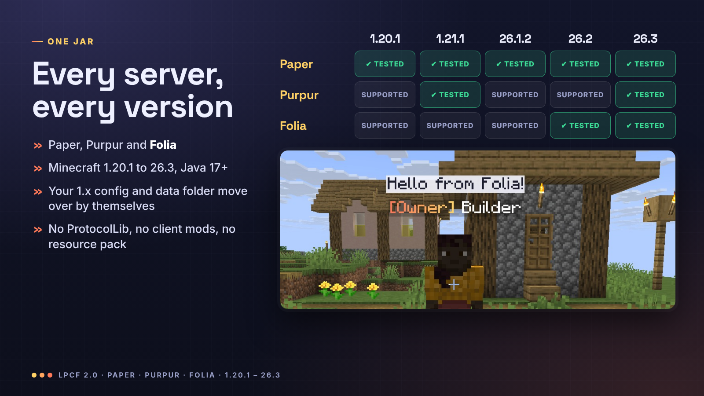

| Server | Minecraft | Notes |
|--------|-----------|-------|
| Paper | 1.20.1 to 26.3 | Everything |
| Purpur | 1.20.1 to 26.3 | Everything |
| Folia | 1.20.1 to 26.3 | Everything except the classic `nametags.style: team` (Folia has no scoreboard teams) |

One file, `LPCF-2.0.0.jar`, for all of them (Java 17 or newer, whatever your server already runs). Tested in game with
real clients on Paper 1.20.1, 1.20.4, 1.21.1, 1.21.11, 26.1.2, 26.2 and 26.3, Purpur 1.21.1 and 26.3, and Folia
26.2 and 26.3. Requires LuckPerms; PlaceholderAPI is optional. Spigot is not supported (LPCF needs Paper's chat API).


**Do players need a mod or resource pack?** No. Nametags and bubbles are vanilla text displays that every client
already shows.

**Does it work with my tab or scoreboard plugin?** Chat and bubbles always do. Above-head nametags hide the vanilla
name with a scoreboard team, like any nametag plugin; if another plugin also manages teams, use one of the two for
nametags (`nametags.style: off` turns LPCF's off). Turn off LPCF's tab header with `tab.header-footer.enabled: false`.

**Will `/home`, `/spawn` or `/tpa` break?** No. On Paper and Purpur nothing rides the player: the nametag follows
them, so teleports work exactly as without LPCF. On Folia the tag rides the player, and Folia teleports the two
together. Both are checked in our tests, through the same API teleport plugins use.

**Does it really work on Folia?** Yes, with the same nametags, bubbles, chat and tab list as Paper. Folia has no
scoreboard teams, so the classic `nametags.style: team` does nothing there; the default text-display nametags ride the
player on Folia, which also hides the vanilla name.

**Do vanished players keep their tag?** No: players with the `vanished` metadata that vanish plugins set, invisible
players and spectators have no tag and no bubbles.

**My prefix does not show.** Run `/lpcf debug <player>`: it shows what LuckPerms returns and which format is used.


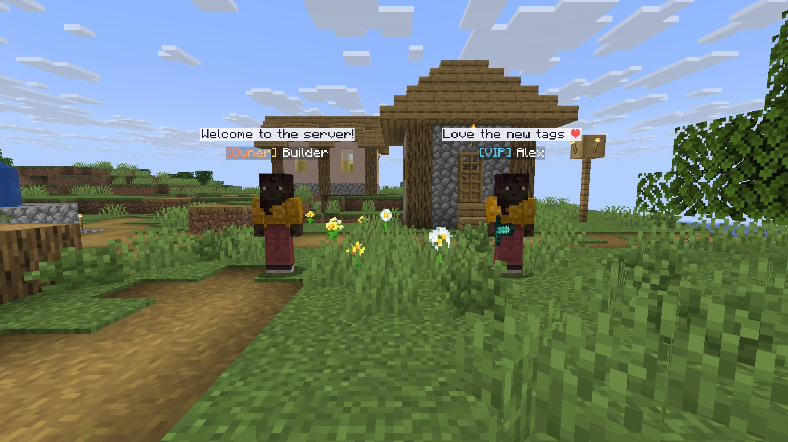

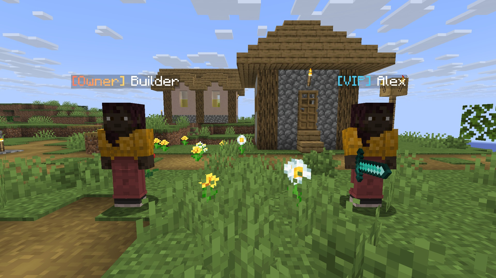

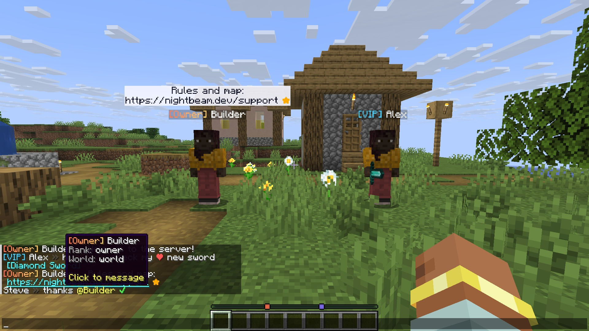

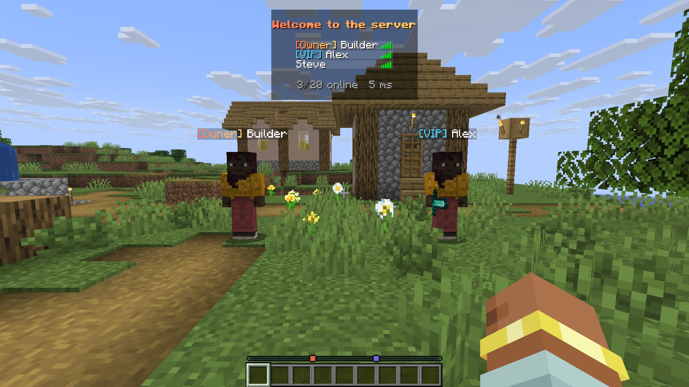

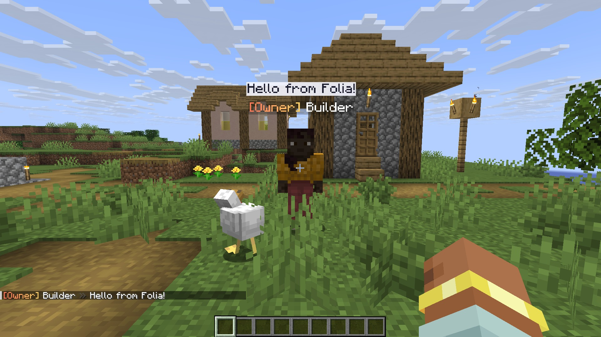


---

> **Running a server?** NightBeam's premium plugins are on [BuiltByBit](https://nightbeam.dev/store): NightWatch Pro anti-cheat, Astral Core and more.

---

### More from NightBeam Studio

- **[Remnants: Ashen Legacy](https://www.curseforge.com/minecraft/modpacks/remnants-ashen-legacy)**: the story-driven soulslike RPG modpack built on NightBeam's mods
- **[Premium server plugins](https://nightbeam.dev/store)**: anti-cheat, ranked PvP, SMP setups and more on BuiltByBit
- **[NightBeam Pro](https://nightbeam.dev/memberships)**: the model library and NightBeam Forge credits, from $5 a month
- **[Discord](https://discord.gg/TJc3CxR4jK)**: support, bug reports, suggestions and early looks
- **[Support NightBeam](https://nightbeam.dev/support)**: help keep every mod free

**Follow:** [YouTube](https://www.youtube.com/@nightbeamstudio) · [Instagram](https://www.instagram.com/nightbeamstudio/) · [X](https://x.com/NightBeamLLC) · [Facebook](https://www.facebook.com/profile.php?id=61574823331471)
